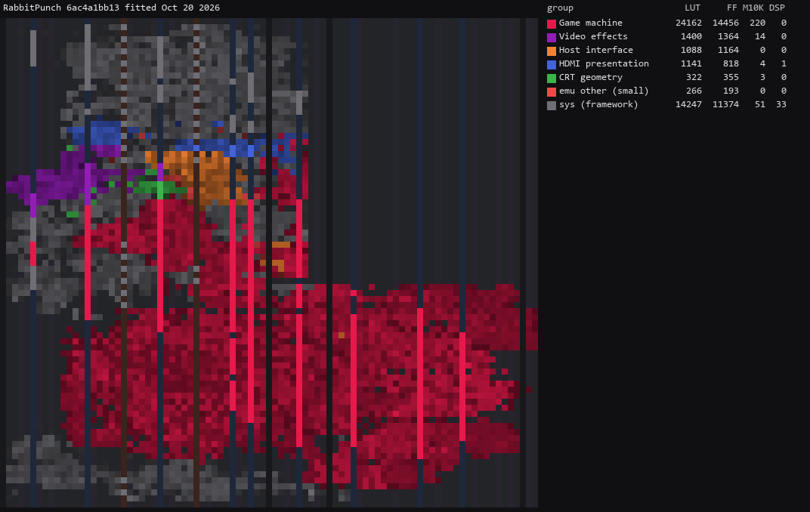

# Rabbit Punch / Rabio Lepus for MiSTer

A MiSTer FPGA core for Video System's 1987 arcade hardware, supporting **Rabbit Punch** and **Rabio Lepus**. Built for the DE10-Nano with Quartus Prime Lite 17.0.2, using MAME 0.289's `vsystem/rpunch.cpp` as the reference.

**Work in progress. Both games run with video and sound. Savestate save and restore work on MiSTer hardware.**

## Contents

- [History](#history)
- [Games](#games)
- [Features](#features)
- [Controls](#controls)
- [High scores and NVRAM](#high-scores-and-nvram)
- [Savestates](#savestates)
- [Installation](#installation)
- [Hardware](#hardware)
- [Building](#building)
- [Verification](#verification)
- [Acknowledgements](#acknowledgements)
- [Repository layout](#repository-layout)
- [License](#license)

## History

### Arcade-RabbitPunch_20261020 — savestates

- Four savestate slots, optional slot autoincrement, Save state and Restore state in the OSD.
- Additional **Savestate (SS)** controller action: hold SS with Down to save or Up to restore.
- Existing controller button positions and separate high-score/NVRAM saving are preserved.
- Deterministic save/restore continuation checks pass for both games, including active audio.
- Release and instrumented builds pass the project's timing checks.
- Savestate save and restore verified on MiSTer hardware.

### Arcade-RabbitPunch_20261018

- Initial public WIP build for Rabbit Punch (US) and Rabio Lepus (Japan).
- Video settings submenu, with aspect ratio, rotation, scaling, flip screen and CRT adjustment.
- DIP switches available through the OSD.
- Corrected Fire/Punch and Missile button labels for both games.
- Optional pause when the OSD is open; audio is muted while paused.
- High-score persistence, with automatic and manual NVRAM saving.

## Games

| Game | Year | Region | MAME set |
|---|---|---|---|
| Rabbit Punch | 1987 | US | `rpunch` |
| Rabio Lepus | 1987 | Japan | `rabiolep` |

Both games use the same RBF. Select the appropriate MRA for the game you want to play. Super Volleyball and other games sharing MAME's driver are outside this core's scope.

## Features

- Two-player controls, keyboard support and controller pause.
- Game-specific DIP switches.
- Aspect ratio and HDMI scaling options.
- HDMI rotation and flip screen; flip screen also applies to analog video.
- CRT position and size adjustment, subject to output-mode restrictions.
- Audio mix options and mute during pause.
- High-score saving through MiSTer's NVRAM interface.
- Four-slot savestates with optional autoincrement.
- Direct ROM loading, with optional DDR-staged loading MRAs.

Development cheat candidates add a **Cheats >** submenu with independent P1/P2 missile, life and energy/shield switches. See [CHEATS.md](docs/CHEATS.md) for matching MRAs and verification status.

The Video settings submenu holds the display options. DIP switches, audio mix, pause behavior, NVRAM and savestate controls are available from the main OSD page.

## Controls

Define controller buttons through MiSTer's **Define joystick buttons** menu. If upgrading from an earlier MRA with Shoot/Missile labels, redefine the buttons to match the corrected order.

| Action | Player 1 keyboard | Player 2 keyboard |
|---|---|---|
| Move | Arrow keys | R / F / D / G |
| Fire/Punch | Left Ctrl | A |
| Missile | Left Alt | S |
| Start | 1 | 2 |
| Coin | 5 | 6 |

| Common action | Keyboard |
|---|---|
| Pause | P |
| Service coin | 9 |
| Test switch | F2 |

Service adds a credit without using the normal coin input. Test is a separate board input; F2 can be held during boot. See [control mapping](docs/CONTROLS.md) for the underlying wiring.

## High scores and NVRAM

High-score tables are saved separately for each game through MiSTer's `.nvm` files. Enable **Autosave NVRAM**, or use **Save NVRAM** in the OSD to request a manual save.

NVRAM contains the high-score table; a full game snapshot requires savestates. DIP settings are handled by MiSTer's per-game configuration. Rabbit Punch defaults to the manual factory settings: 3 lives and demo sound On. Existing saved DIP settings take precedence; use Reset after changing gameplay DIPs.

## Savestates

Savestates are included in the **October 20 build**. The same RBF supports
both games. This build passes deterministic continuation tests in simulation.
Save and restore also work on MiSTer hardware.

The main OSD places these controls together after **Save NVRAM**:

| Control | Function |
|---|---|
| Savestate slot | Select slot 1–4 |
| Autoincrement slot | Advance to the next slot after a successful save |
| Save state | Capture the running game in the selected slot |
| Restore state | Resume the selected snapshot |

Assign **Savestate (SS)** through MiSTer's **Define joystick buttons** menu.
Hold SS and press **Left/Right to select a slot**, **Down to save** or **Up to
restore**. Slot selection wraps between 1 and 4 and stays synchronized with the
OSD, with a brief **Savestate slot 1-4** popup on each accepted SS + Left/Right change. Save uses the selected slot and autoincrement setting. SS has no default assignment; existing button
positions are unchanged. That controller's game inputs are suppressed while
SS is held.

Savestates and high-score NVRAM are separate features. See
[savestate implementation and validation](docs/SAVESTATES.md) for test coverage
and current limitations.

## Installation

1. Download [`Arcade-RabbitPunch_20261020.rbf`](releases/Arcade-RabbitPunch_20261020.rbf) and the matching game MRA from [`releases/`](releases/). The earlier [`October 18 build`](releases/Arcade-RabbitPunch_20261018.rbf) remains available without savestates.
2. Copy the RBF to `_Arcade/cores/` on your MiSTer.
3. Copy the MRA to `_Arcade/`.
4. Place the matching ROM ZIP files in `games/mame/` and launch the game through its MRA.

The MRAs were verified against **MAME 0.289**. A merged `rabiolep.zip` includes the files needed for both games. ROMs are not included.

Optional DDR-loading MRAs are under [`releases/_alternatives/_ddr/`](releases/_alternatives/_ddr/). These stage the download through onboard DDR3; the games still run from the external SDRAM module. The diagnostic MRA is intended for development and requires a separately generated test ROM.

## Hardware

| Component | Function | Implementation |
|---|---|---|
| Motorola 68000, 8 MHz | Main game CPU | fx68k |
| Z80, 4 MHz | Sound CPU | T80 |
| YM2151, 4 MHz | FM music | JT51-derived VHDL with state capture |
| uPD7759, 640 kHz | ADPCM samples | JT7759-derived VHDL with state capture |
| Video System video hardware | Tile layers, sprites, bitmap layer and priority | VHDL board logic with reused JTFRAME drawing components |
| External SDRAM | Game ROM storage | Single-module SDRAM controller |
| FPGA block RAM | Board RAM, caches and line buffers | Inferred FPGA memory |

The game runs on one system clock with clock enables for the board components. Rendering proceeds one scanline ahead through alternating line buffers. Optional HDMI rotation uses the MiSTer DDR3 presentation path.

### Video timing

- System clock: **46.667 MHz**.
- Pixel clock: **6.667 MHz**, one pixel every seven system clocks.
- Raster: **432 pixels x 256 lines**, with **288 x 216** visible.
- Horizontal frequency: approximately **15.432 kHz**.
- Refresh rate: approximately **60.282 Hz**.
- Display aspect: **4:3**, or **3:4** when rotated.

These are the implemented timings. Original-board raw raster timings have not been established; [the timing notes](docs/PROVISIONAL_RASTER.md) record the evidence and assumptions.

### Resource usage

RabbitPunch release revision, fitted October 20, 2026, seed 3, source `6ac4a1b`:

| Resource | Used | Available |
|---|---:|---:|
| Logic (ALMs) | 22,889 | 41,910 |
| Registers | 29,824 | 83,820 |
| Block memory bits | 2,303,968 | 5,662,720 |
| M10K blocks | 292 | 553 |
| DSP blocks | 34 | 112 |
| PLLs | 3 | 6 |

All **144 scoped timing checks** pass, with minimum setup slack **+0.225 ns** and hold slack **+0.112 ns**. The [release build report](docs/reference/state_production_release_seed3_synth_checks.json) records the source, seed, artifact hashes and timing scope. The instrumented build also passes all 164 project timing checks.

### Floorplan

RabbitPunch release revision, fitted October 20, 2026, seed 3. Colors identify the game machine, video processing, host interface and MiSTer framework; brightness indicates occupancy.



[Resource groups](docs/floorplan/RabbitPunch_20261020_groups.md).

## Building

Use **Quartus Prime Lite 17.0.2**, including Cyclone V device support. Native simulation uses ModelSim; scripts require Python 3. Additional simulation tools are described in [toolchain setup](docs/TOOLCHAIN.md).

Set local tool and ROM paths in the gitignored `mister.env`. Reference captures require matching MAME 0.289 source and executable.

From a clean, committed checkout on Windows:

```powershell
.\scripts\d_drive.ps1 scripts/build_staged.py --rev RabbitPunch --seed 3
```

The staged build records its source commit and fitter seed and checks implementation results before accepting the artifact. See [working practice](docs/WORKFLOW.md) and [release process](docs/RELEASE_PROCESS.md).

## Verification

The core is checked against MAME for ROM loading and graphics, with simulation tests and Quartus timing analysis. Music and sound effects have been verified against MAME for both games. See [audio verification](docs/AUDIO_VERIFICATION.md) for the tested passages and results.

Both games pass two saves and four restores with exact continuation in simulation. Focused native tests cover CPU STOP/HALT, interrupt state, repeated restores and recovery after an incomplete restore. Both production Quartus revisions pass their timing and state-resource checks. See [savestate validation](docs/SAVESTATES.md) for the evidence and scope.

Savestate save and restore have been tested on MiSTer hardware. NVRAM saving, controller mappings and HDMI rotation were hardware-tested on earlier builds. CRT output remains untested.

Detailed results are in [`docs/reference/`](docs/reference/). The [October 20 build report](docs/reference/state_production_release_seed3_synth_checks.json) identifies the savestate build; [build identity mapping](docs/reference/publication_identity_checks.json) records the earlier published build.

[Roadmap](docs/ROADMAP.md) | [Known approximations](docs/HACKS.md) | [MAME behavior notes](docs/MAME_KLUDGES.md) | [Sound](docs/SOUND_BRINGUP.md) | [Savestates](docs/SAVESTATES.md)

## Acknowledgements

- **Pugsy and cheat contributors**, for the historical Rabbit Punch / Rabio Lepus cheat definitions. See [cheat implementation and validation](docs/CHEATS.md).

- **MiSTer developers and contributors** for the platform and core template.
- **MAME developers** for the Rabbit Punch / Rabio Lepus hardware model and reference implementation.
- **Jorge Cwik** for fx68k.
- **Daniel Wallner and contributors** for T80.
- **Jose Tejada Gomez (jotego)** for JTFRAME, JT51 and JT7759.
- **Sorgelig and contributors** for the SDRAM and MiSTer video components.
- **Umberto Parisi and Andrea Bogazzi** for CRT Adjust.
- **ppriest** for [MiSTer-CoreSkill](https://github.com/ppriest/MiSTer-CoreSkill), worked core examples and development guidance.

Development assisted by OpenAI Codex.

Component origins, donor revisions and license notices are recorded in [THIRD-PARTY.md](THIRD-PARTY.md) and the individual `PROVENANCE.md` files.

## Repository layout

| Path | Contents |
|---|---|
| `releases/` | RBF, game MRAs and loading alternatives |
| `rtl/` | Board implementation, adapters and third-party components |
| `sys/` | MiSTer framework |
| `sim/` | Testbenches and simulation support |
| `scripts/` | Build, capture, validation and development tools |
| `docs/` | Hardware notes, design, verification and development status |

## License

[GPL-3.0-or-later](LICENSE), with third-party components retaining their own license notices. See [THIRD-PARTY.md](THIRD-PARTY.md).
